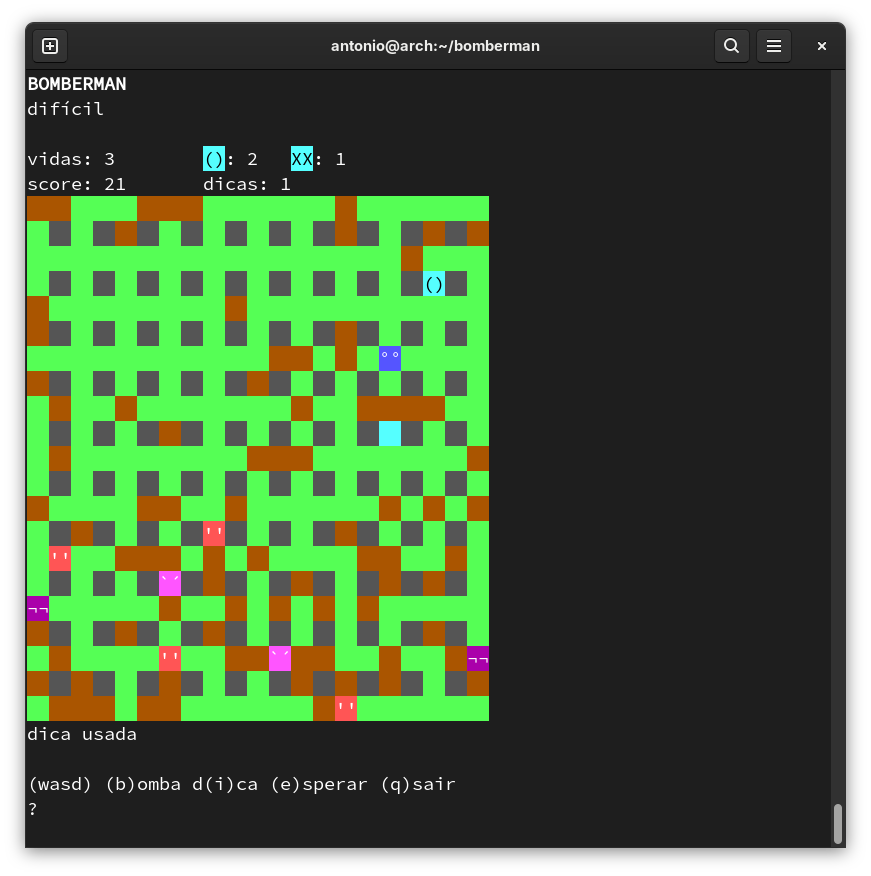

# fickel0/bomberman

> [!NOTE] 
> This is coursework for Computer Engineering at UFPel. It's educational. You might find a lot of Brazilian Portuguese.

Bomberman-like game in the terminal, in Java, using only the standard library. My colleague and I built this to practice the 4 pillars of object-oriented programming: encapsulation, abstraction, inheritance, and polymorphism. I myself (fickel0) am not particularly fond of OOP, but I guess I see the point.

You know the drill: plant bombs, blow up crates, get power-ups. To win, either find the exit hidden under the crates or eliminate all enemies (three types included). You get +1 point for every crate and +5 for every enemy you blow up. Every 10 points you get a hint that'll highlight a power-up on the map. 

Movement is a bit limited because the user is required to press Enter after every keystroke (it's just a `Scanner`). That could be solved, however it's outside the scope of this project. What matters most is the code here, not the gaming experience, although I did try to make the game look cute with ANSI codes.

*This is how it looks like on my end.*

The next step of the project is to turn this into a Swing application, so we made sure to separate game logic and UI as much as possible. You can also save game state to `save.dat` and load it later. 

**Run it with `make run`.**
